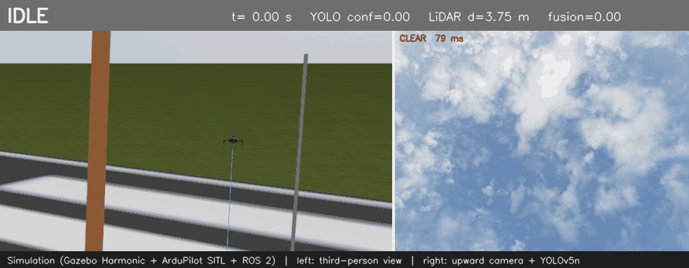
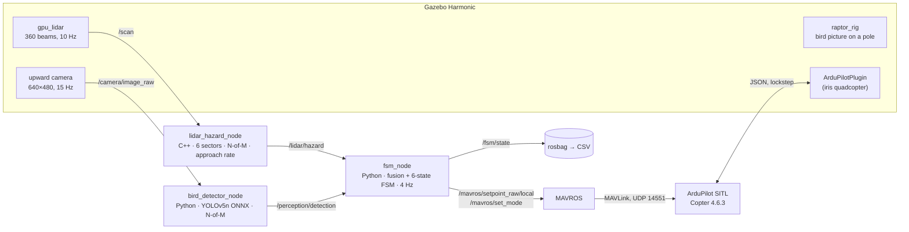
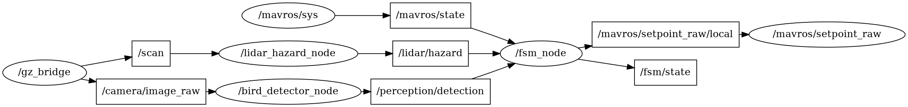
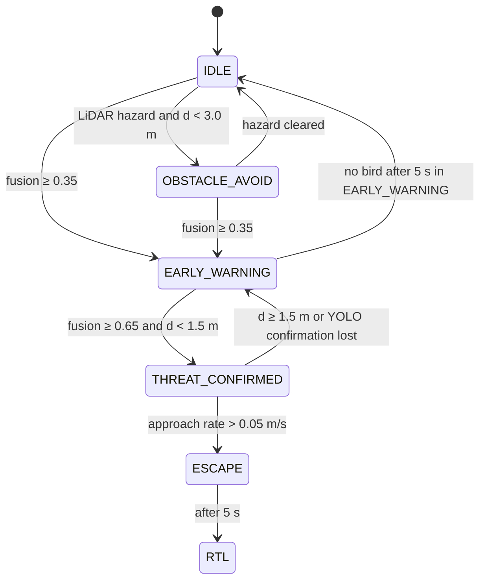
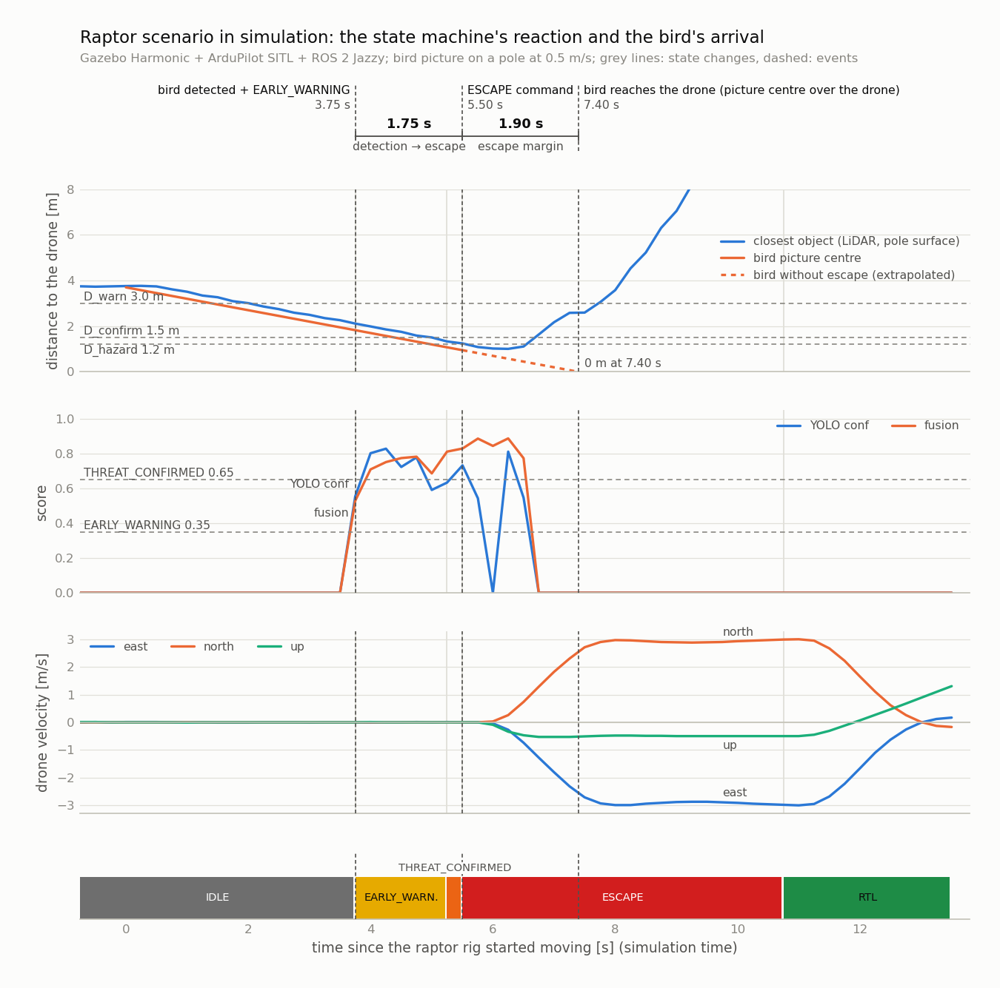

# UAV Raptor Detection and Avoidance (ROS 2)

A ROS 2 Jazzy re-implementation of my
[raptor detection and avoidance system](https://github.com/AycanCoskun/uav-raptor-detection-avoidance-system)
for UAVs: LiDAR obstacle detection (C++), YOLOv5n bird detection (Python, ONNX Runtime) and a
six-state sensor fusion state machine that commands ArduPilot through MAVROS.

> **Simulation only.** Everything in this repository runs in Gazebo Harmonic with ArduPilot SITL
> and MAVROS on Ubuntu 24.04 (WSL2). No hardware was used, and no real bird. The original system
> ran on a Jetson Nano prototype and is described in the paper listed under [Background](#background).
> This port keeps the paper's decision logic and parameter values and replaces the CSV files that
> connected the original modules with ROS 2 topics.



*A bird picture on a pole (the simulation counterpart of the paper's printed raptor) approaches the
hovering drone. Left: third-person view. Right: the drone's upward camera with YOLOv5n detections.
The state machine goes IDLE → EARLY_WARNING → THREAT_CONFIRMED → ESCAPE and then RTL. Played at
simulation speed.*

## What it does

- **LiDAR hazard detection (C++).** A 360° scan is split into six 60° sectors; a hazard is an
  object closer than 1.2 m, confirmed by an N-of-M filter (N = 2, M = 3). The node also computes
  the approach rate of the closest object.
- **Bird detection (Python).** YOLOv5n (COCO class 14, `bird`) on the upward-facing camera through
  ONNX Runtime on the CPU, with the same pre- and post-processing as the original TensorRT
  pipeline and the same N-of-M confirmation.
- **Decision making (Python).** A weighted fusion score `T = clip(0.6·C_yolo + 0.4·P_lidar, 0, 1)`
  drives a six-state machine at 4 Hz. LiDAR alone can only trigger obstacle avoidance; the raptor
  pipeline (escape and return-to-launch) always needs the camera and the LiDAR to agree.
- **Flight commands.** Velocity setpoints and mode changes (GUIDED, RTL) go to ArduPilot through
  MAVROS.
- **Reproducible tests.** One launch file starts everything; a scenario node runs the raptor and
  the obstacle scenarios and reports PASS/FAIL; every run can be recorded as a rosbag and exported
  to CSV.

## Architecture



Sensor topics reach ROS 2 through `ros_gz_bridge`. The graph below was generated from the running
system with rqt_graph's graph generator; the test tools and the MAVROS plugins that the nodes do
not use are hidden:



### Packages

| Package | Language | Contents |
|---|---|---|
| `raptor_interfaces` | msg | `LidarHazard`, `VisionDetection`, `FsmState` (SI units) |
| `raptor_lidar` | C++ (rclcpp) | ROS-free `HazardDetector` core + `lidar_hazard_node`, 18 gtest tests |
| `raptor_perception` | Python | ROS-free `YoloV5Detector` + `bird_detector_node`, `bird_range_sweep` test tool, 8 pytest tests |
| `raptor_fsm` | Python | ROS-free `RaptorFsm` + `fsm_node`, `scenario_node`, `export_run_csv`, `demo_recorder`, 18 pytest tests |
| `raptor_bringup` | launch / config | `raptor.launch.py`, `raptor_params.yaml`, Gazebo world and models, bridge config, RViz config |

The decision logic of each package lives in a ROS-free core (`hazard_detector.cpp`,
`yolo_detector.py`, `fsm_core.py`), so it is unit-tested without ROS; the nodes only move data
between topics and the core.

### Interfaces

| Topic | Type | Publisher → subscriber |
|---|---|---|
| `/scan` | `sensor_msgs/LaserScan` | Gazebo → `lidar_hazard_node` |
| `/camera/image_raw` | `sensor_msgs/Image` | Gazebo → `bird_detector_node` (QoS best effort, depth 1: always the newest frame) |
| `/lidar/hazard` | `raptor_interfaces/LidarHazard` | hazard, confirmed, `min_range_m`, `approach_rate_mps`, `sector_blocked` |
| `/perception/detection` | `raptor_interfaces/VisionDetection` | hazard, confirmed, `max_conf`, `cx_norm`, `cy_norm`, `inference_ms` |
| `/fsm/state` | `raptor_interfaces/FsmState` | state, active layer, fusion and proximity scores, last command (one per tick) |
| `/mavros/setpoint_raw/local` | `mavros_msgs/PositionTarget` | `fsm_node` → MAVROS (velocity only, `FRAME_LOCAL_NED`) |
| `/mavros/set_mode` | `mavros_msgs/srv/SetMode` | `fsm_node` → MAVROS (GUIDED, RTL) |

## Decision logic



- Proximity score `P = clip((D_warn − d) / (D_warn − D_hazard), 0, 1)` with `d` the range of the
  closest LiDAR object. Fusion is 0 when the YOLO confidence is ≤ 0.05.
- YOLO alone reaches at most 0.6 and the LiDAR alone at most 0.4, both below the THREAT_CONFIRMED
  threshold, so an escape always needs both sensors.
- The state machine moves by at most one state per tick (4 Hz).
- As in v3, OBSTACLE_AVOID reacts to the LiDAR hazard flag of the latest scan. Of the two N-of-M
  confirmations only the YOLO one is used: THREAT_CONFIRMED falls back when it is lost.
- **ESCAPE** sends a NED velocity every tick: `vx = 3.0` m/s, `vy = ±3.0` m/s away from the bird's
  horizontal image position, `vz = −1.5` (up) or `+0.5` (down) from its vertical image position.
- **OBSTACLE_AVOID** sidesteps away from the blocked sector at 1.5 m/s (moves forward at 1.0 m/s if
  the back sector is blocked), scaled by 1.0 / 0.5 / 0 for distances above 2 m / 1–2 m / below 1 m.

All values are in [`raptor_bringup/config/raptor_params.yaml`](raptor_bringup/config/raptor_params.yaml):

| Parameter | Value | Parameter | Value |
|---|---|---|---|
| Fusion weights (YOLO / LiDAR) | 0.6 / 0.4 | EARLY_WARNING / THREAT_CONFIRMED | 0.35 / 0.65 |
| D_warn / D_confirm / D_hazard | 3.0 / 1.5 / 1.2 m | Approach rate threshold | 0.05 m/s (50 mm/s) |
| N-of-M (LiDAR and YOLO) | 2 of 3 | YOLO class / confidence | 14 (bird) / 0.35 |
| Loop rate | 4 Hz | ESCAPE duration / EARLY_WARNING timeout | 5.0 s / 5.0 s |

## Results (simulation)

All results come from runs in this simulation; times are simulation time. With every node running
on the development PC the real-time factor was about 0.5. The FSM keeps its 4 Hz in simulation time,
and ArduPilot SITL runs in lockstep with Gazebo.

### Raptor scenario

The drone hovers at 10 m. The raptor rig's pole starts 4 m east of it and approaches at 0.5 m/s; the
bird picture is 0.3 m in front of the pole and 2.0 m above the camera. The upward camera sees the
picture and the horizontal LiDAR sees the pole. As in the paper, the state machine fuses the bird
confidence with the range of the closest LiDAR object.



*Time 0 is the first rig command. The bird picture is 2.0 m above the camera, so "reaches the
drone" means that the picture centre passes over the drone; its position is the rig's start
position plus its speed (0.5 m/s) times the time. Against the scan times in the recorded bag, the
LiDAR pole distance follows this motion within 1 cm (rms 8 mm). The rig itself stops with the
picture 0.5 m from the drone, so the arrival without an escape is extrapolated. Each state machine
decision takes at most one 0.25 s tick. The state machine decided on the LiDAR distance to the
pole, so it saw the bird about 0.25 m farther away than it was (a test-rig artefact).*

| Transition | Time | Values ([run data](docs/results/scenario_raptor_sim.csv)) |
|---|---|---|
| IDLE → EARLY_WARNING | 3.75 s | fusion 0.53, d = 2.11 m |
| EARLY_WARNING → THREAT_CONFIRMED | 5.25 s | fusion 0.81, d = 1.33 m |
| THREAT_CONFIRMED → ESCAPE | 5.50 s | approach rate 0.49 m/s; bird at cx = 0.75, cy = 0.49 → NED (3.0, −3.0, 0.5) m/s |
| ESCAPE → RTL | 10.75 s | after 5 s of escape (+ one tick) |

- The escape vector is the same as in the paper's SITL test (Table 4: (3.0, −3.0, 0.5)).
- The vehicle's velocity estimate showed motion 0.26 s after the escape command (its first sample
  after it; the CSV, which holds the latest sample at each tick, shows it one tick later) and
  reached the commanded velocity about 2 s later. In 5 s it moved 11.5 m north, 11.5 m west (16 m) and 2.3 m down, then flew home in RTL
  (the first two runs were recorded until it had landed and disarmed).
- The scenario passed in all five recorded runs (in the first three the picture was 2.2 m above
  the camera because of a height offset that was fixed later). Transition times varied by less
  than 0.5 s between runs.

### Obstacle scenario

The drone flies north at 0.2 m/s towards a static pillar and stops commanding 1.6 m before it,
so only the state machine commands the vehicle when the hazard appears. Result: IDLE →
OBSTACLE_AVOID at d = 1.15 m (sector FRONT, sidestep east at 0.75 m/s) → IDLE with a hover command
1.75 s later. The closest distance was 1.06 m ([run data](docs/results/scenario_obstacle_sim.csv)).

### Sensors

- **LiDAR node.** The drone hovering at 10 m was moved towards the pillar. The hazard appeared at
  1.16 m and was confirmed one scan later in sector FRONT. The approach rate peaked at +1.85 m/s
  (−1.75 m/s moving back), with hover noise ≤ 0.055 m/s.
- **Bird detector.** On a COCO test image the ONNX pipeline matched the thesis TensorRT FP16 results
  (8/8 detections, confidence within ±0.004). Inference took a median of 64 ms on 2 CPU threads with
  Gazebo running. A range sweep of the 0.5 m bird picture above the camera
  ([data](docs/results/bird_range_sweep_sim.csv)) detected it up to 5.0 m. The result depends on
  the picture's orientation: at the orientation used in the scenarios it was detected at every
  distance from 1.0 to 3.0 m. The paper's theoretical camera range is 6.7 m; with this camera the
  bird is about 19 px wide at that distance.

### Findings from closing the loop in simulation

1. **"Stop and hold" can lock the obstacle avoidance.** The paper's speed factor is 0 below 1.0 m,
   and OBSTACLE_AVOID only ends when the hazard clears. In a run at 0.5 m/s the drone entered the
   state at 1.09 m, was below 1.0 m one tick later and stayed at 0.76 m. The paper's SITL test did
   not show this, because there the obstacle was moved in front of the real LiDAR while the
   simulated vehicle never approached it. The logic is kept as published and the scenario
   approaches slowly. A fix would be to back away from the blocked sector instead of holding.
2. **One command source at a time.** In an early run the scenario node and the state machine both
   published velocity setpoints, and the scenario overrode the state machine's first sidestep. The
   scenario now stops commanding before the hazard distance.

### Limitations

- **Simulated physics.** Vehicle dynamics are idealised: no wind, no sensor noise beyond Gazebo's,
  and the approach speeds are slow (0.5 m/s) compared with a diving raptor (the paper assumes
  69.4 m/s). The runs show the decision chain working end to end, not the timing margins.
- **A picture, not a bird.** The target is a static bird picture, so detection depends on its
  orientation and distance. The fusion does not associate the LiDAR object with the detected bird
  (as in the paper); the rig is staged so that both sensors see the same object.
- **Original conventions kept.** Escape velocities are in the local NED frame and assume the drone
  faces north, as in the original. The vertical escape direction comes from the bird's vertical
  image position, although the camera points up.

## Differences from the original system

| Original (Jetson Nano prototype) | This repository (simulation) |
|---|---|
| Modules exchange CSV files | ROS 2 topics with custom messages |
| RPLIDAR A2M8, Python | Gazebo `gpu_lidar`, C++ node (angles converted from RPLIDAR clockwise to ROS counter-clockwise) |
| ZED 2 camera, YOLOv5n TensorRT FP16 | Gazebo camera, the same YOLOv5n weights on ONNX Runtime (CPU) |
| pymavlink to a Pixhawk 6X / SITL | MAVROS to ArduPilot SITL |
| Printed raptor picture held by a person | `raptor_rig`: bird picture on a pole, moved by Gazebo's VelocityControl system |

Deliberate changes to `state_machine_v3.py`, commented in `fsm_core.py`:

- The transitions follow the paper (Fig. 1). In particular, THREAT_CONFIRMED needs d < 1.5 m and
  falls back to EARLY_WARNING when d ≥ 1.5 m or the YOLO confirmation is lost.
- During ESCAPE the direction is only recomputed while the bird is detected. The original fell
  back to the image centre when the bird left the frame, which could turn the escape towards the bird.

## Build and run

**Requirements:** Ubuntu 24.04, ROS 2 Jazzy (`ros-jazzy-desktop`), Gazebo Harmonic with
`ros-jazzy-ros-gz`, MAVROS (`ros-jazzy-mavros`, `ros-jazzy-mavros-extras` and the GeographicLib
datasets), [ArduPilot](https://github.com/ArduPilot/ardupilot) Copter-4.6.3 SITL and
[ardupilot_gazebo](https://github.com/ArduPilot/ardupilot_gazebo) with `GZ_SIM_SYSTEM_PLUGIN_PATH`
and `GZ_SIM_RESOURCE_PATH` set.

```bash
sudo apt install python3-pip python3-opencv python3-matplotlib
python3 -m pip install --user --break-system-packages --no-deps onnxruntime==1.31.1
mkdir -p ~/raptor_ws/src && cd ~/raptor_ws/src
git clone https://github.com/AycanCoskun/uav-raptor-avoidance-ros2.git
```

The YOLOv5n ONNX model is not in the repository. Export it as described in
[`raptor_perception/models/README.md`](raptor_perception/models/README.md), then build and test:

```bash
cd ~/raptor_ws && colcon build --symlink-install
colcon test && colcon test-result --verbose
source install/setup.bash
```

Run the full loop in two terminals:

```bash
# Terminal 1: ArduPilot SITL (with ArduPilot's Python environment active)
cd ~/ardupilot && sim_vehicle.py -v ArduCopter -f gazebo-iris --model JSON --out udp:127.0.0.1:14551

# Terminal 2: Gazebo, sensors, nodes, MAVROS and a scenario (it takes off by itself)
ros2 launch raptor_bringup raptor.launch.py scenario:=raptor record:=true bag_path:=raptor_run
```

| Launch argument | Default | Meaning |
|---|---|---|
| `scenario` | `none` | `raptor`, `obstacle` or `none` (fly it yourself) |
| `record` / `bag_path` | `false` / `raptor_run` | record the run as a rosbag |
| `mavros` / `fcu_url` | `true` / `udp://:14551@` | start MAVROS and where to connect |
| `rviz` | `false` | RViz with the LiDAR scan and the camera image |
| `demo_camera` | `false` | third-person camera for `ros2 run raptor_fsm demo_recorder` |

After a run:

```bash
ros2 run raptor_fsm export_run_csv raptor_run raptor_run.csv
python3 ~/raptor_ws/src/uav-raptor-avoidance-ros2/docs/scripts/plot_scenario.py raptor_run.csv raptor_run.png
```

## Repository layout

```text
raptor_interfaces/   custom messages
raptor_lidar/        C++ LiDAR hazard node and gtest tests
raptor_perception/   YOLOv5n detector node, range sweep tool, pytest tests
raptor_fsm/          state machine node, scenario runner, run export and demo tools, pytest tests
raptor_bringup/      launch files, parameters, Gazebo world and models, bridge and RViz config
docs/                result CSVs, images and the plotting script
```

## Background

The original system was my BEng (Hons) Computer Systems Engineering final-year project at Brunel
University London. It is described in:

A. Coskun and T. Kalganova, "Latency-Aware Multi-Sensor Fusion for Autonomous Bird–Drone Collision
Avoidance on UAVs", accepted at icSoftComp 2026 (Springer CCIS).

## License

AGPL-3.0 (see [`LICENSE`](LICENSE)), because the perception node uses Ultralytics YOLOv5 (AGPL-3.0).
Third-party files and assets are listed in [`NOTICE.md`](NOTICE.md).
